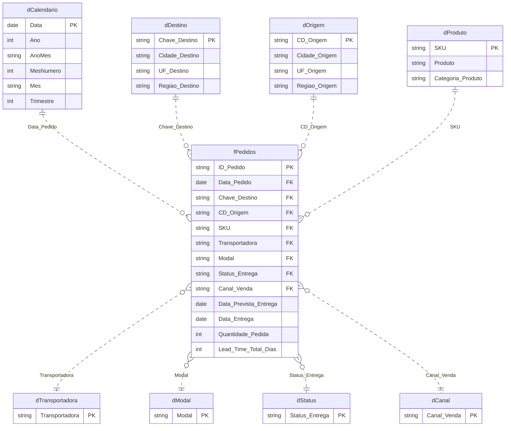

# Logistics Analytics

Estudo de caso de BI logístico em **Power BI**, desenvolvido com **OpenAI Codex** e **Power BI Authoring MCP**. O painel ajuda a identificar onde melhorar o nível de serviço, acompanhar o custo por pedido e priorizar a carteira em aberto.

**[Abrir o dashboard interativo](https://app.powerbi.com/view?r=eyJrIjoiM2JhY2RjODEtM2IzOC00Y2ViLTgxM2EtNjU1MWQwZGRmMGMxIiwidCI6IjZkNTRhM2Y3LTM4YzItNDM2Ni1iNGNiLWVlZTg4NjI0NDI5NiJ9&pageName=556cee0099956be5cb00)**

## Decisões apoiadas

A fonte reunia datas, custos, status e ocorrências em uma planilha. O painel organiza esses dados para duas rotinas com perguntas diferentes.

| Página | Pergunta de negócio |
| --- | --- |
| Capa | Qual é o panorama do período e do nível de serviço? |
| Estratégia | Como serviço e custo evoluíram? Onde há mais falhas ou menor OTIF? |
| Operação | Onde os atrasos se concentram e quais pedidos precisam ser revisados primeiro? |

## Resultados no recorte completo

A base é simulada e contém **1.000 pedidos únicos**, registrados de **01/07/2025 a 10/07/2026**. A carteira operacional reflete a posição da fonte em **15/07/2026**.

| Indicador | Resultado | Como interpretar |
| --- | ---: | --- |
| OTIF | **86,60%** | 827 pedidos no prazo e completos entre 955 elegíveis. |
| Custo logístico | **R$ 82.940,80** | R$ 82,94 por pedido no recorte. |
| Lead time médio | **5,91 dias** | Média de 950 entregas com lead time válido. |
| Carteira ativa | **24 pedidos** | 21 com status Atrasado e 3 Em trânsito. |

O **Sudeste** concentrou **61 das 128 falhas de OTIF**. O **Norte** teve o menor OTIF (**74,0%**, em 50 pedidos elegíveis). Volume e taxa ajudam a escolher por onde começar a investigação.

## Arquitetura

**Excel → Power Query → Modelo estrela → DAX → JSON Gold → HTML Content**

O Codex usou o MCP local para inspecionar o modelo, editar medidas no Power BI Desktop e executar consultas DAX. Duas skills orientaram a modelagem e a construção dos visuais. As medidas DAX definem os indicadores. O JSON Gold leva os dados e os componentes dos cálculos ao HTML, que lê o contexto dos filtros do relatório.

## Modelo dimensional

A fato `fPedidos` tem **uma linha por pedido**, com a chave `ID_Pedido`. O diagrama mostra os relacionamentos ativos **1:***. O filtro segue da dimensão para a fato. A relação ativa do calendário usa `Data_Pedido`.

`PK` indica chave única da tabela. `FK` indica a coluna de ligação na fato. As cinco relações inativas do calendário estão na [referência do modelo](docs/modelo-e-medidas.md).

## Como reproduzir

1. No Windows, conecte o Codex ao Power BI Desktop pelo [guia do MCP](docs/conexao-mcp.md).
2. Use o [guia de construção e validação](docs/construcao-e-validacao.md) para carregar a planilha simulada, configurar o modelo e recriar as medidas e as páginas.
3. Aproveite as [skills e os prompts do projeto](docs/prompts-e-skills.md) para repetir o fluxo ou adaptar a solução a outra base.

A validação confirmou 1.000 IDs únicos, a preservação dos 50 pedidos sem data de entrega e a reconciliação dos KPIs com o JSON. Para comparar meses parciais, a análise usa os mesmos dias em ambos os períodos.

## Organização do repositório

| Pasta | Conteúdo |
| --- | --- |
| `docs/` | Caso de negócio, arquitetura, modelo e guia de reprodução. |
| `docs/base/` | Planilha simulada, dicionário de dados e premissas. |
| `docs/skills/` e `docs/prompts/` | Skills, materiais de apoio e prompts utilizados. |
| `assets/` | Prévias das páginas, organização das medidas e 53 expressões DAX. |
| `examples/` | Consultas Power Query, validações DAX e exemplo de incorporação. |

[Caso de negócio](docs/caso-de-negocio.md) · [Arquitetura e decisões técnicas](docs/arquitetura.md) · [Catálogo DAX](assets/medidas/README.md)

O relatório está disponível por **Publicar na Web**. A demonstração usa dados e transportadoras simulados.
