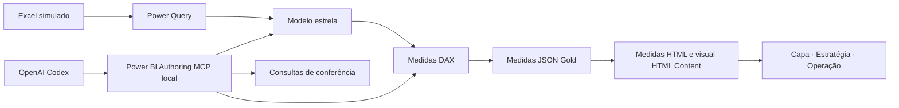

# Logistics Analytics

Estudo de caso de **BI logístico com Power BI Desktop, OpenAI Codex e Model Context Protocol (MCP)**. O projeto transforma uma base simulada de pedidos em duas visões de decisão. A **Estratégia** orienta onde melhorar serviço e custo. A **Operação** mostra quais pedidos precisam de atenção na posição registrada pela fonte.

**[Abrir o dashboard interativo no Power BI](https://app.powerbi.com/view?r=eyJrIjoiM2JhY2RjODEtM2IzOC00Y2ViLTgxM2EtNjU1MWQwZGRmMGMxIiwidCI6IjZkNTRhM2Y3LTM4YzItNDM2Ni1iNGNiLWVlZTg4NjI0NDI5NiJ9&pageName=556cee0099956be5cb00)** · [Guia de conexão MCP](docs/conexao-mcp.md) · [Prompts e skills](docs/prompts-e-skills.md)

## O problema

A gestão logística precisava distinguir **onde o serviço estava pior**, **onde havia mais falhas para reduzir** e **quais pedidos estavam na fila operacional**. A informação original estava em uma planilha única, com datas de pedido, expedição e entrega, status, custos e ocorrências. Uma página única reunia perguntas de públicos diferentes e dificultava a priorização.

O desafio técnico era preservar a granularidade, os denominadores e o contexto de filtro durante toda a cadeia. Isso inclui manter pedidos sem entrega, calcular OTIF no nível do pedido, comparar períodos parciais equivalentes e permitir filtros internos num visual HTML.

| Página | Pergunta | Entrega |
| --- | --- | --- |
| Capa | O que é o projeto e qual período está disponível? | Prévia de OTIF, pedidos, lead time e tendência mensal. |
| Estratégia | Como o serviço e o custo evoluíram, e em quais regiões vale concentrar melhorias? | Quatro KPIs, uma tendência alternável e prioridades por taxa de falha e por impacto. |
| Operação | Quais pedidos precisam de atenção e em que ordem? | Carteira ativa, agrupamento dos atrasos e fila ordenada por status e previsão de entrega. |

## Resultados no recorte completo

| Evidência | Resultado |
| --- | ---: |
| Pedidos únicos | 1.000 |
| OTIF | **86,60%** · 827 de 955 elegíveis |
| Custo logístico | **R$ 82.940,80** · R$ 82,94 por pedido |
| Lead time de entregas concluídas | **5,91 dias** |
| Carteira na posição de 15/07/2026 | **24 pedidos** · 21 com status Atrasado e 3 Em trânsito |

O **Sudeste** concentra **61 das 128 falhas de OTIF**. O **Norte** tem a menor taxa de OTIF (**74,0%**, com 13 falhas em 50 elegíveis). Esse recorte mostra por que a taxa e o volume devem aparecer juntos. Os números descrevem **dados simulados**, com pedidos de **01/07/2025 a 10/07/2026**.

## Como o projeto foi desenvolvido

O **Codex** recebeu objetivos, regras e critérios de aceite em prompts por etapa. O **Power BI Authoring MCP**, da Microsoft, expôs operações de leitura, modelagem, edição de medidas e execução de DAX no Desktop. As **skills** codificaram o método de trabalho. A colocação dos visuais e a publicação foram verificadas no Power BI.

## Leia e reproduza

| Documento | Conteúdo |
| --- | --- |
| [Caso de negócio](docs/caso-de-negocio.md) | Perguntas, desenho das páginas, definições, evidências e limites. |
| [Conexão Codex ↔ Power BI via MCP](docs/conexao-mcp.md) | Instalação no Windows, configuração, primeiro teste e solução de problemas. |
| [Construção e validação](docs/construcao-e-validacao.md) | Power Query, modelo, DAX, JSON Gold, experiência HTML e validação. |
| [Skills e prompts reutilizáveis](docs/prompts-e-skills.md) | Exemplo de skill e prompts do processo em etapas. |
| [Consultas DAX de conferência](examples/validacao.dax) | Totais, denominadores, períodos equivalentes e carteira operacional. |
| [Exemplo de incorporação](examples/powerbi-embed.html) | HTML responsivo para incorporar o relatório em um site. |

[Ver prévia da Capa](assets/capa.png) · [Ver prévia da Operação](assets/operacao.png)

> O relatório interativo usa **Publicar na Web** e está disponível a qualquer pessoa com o link. Use esse modo somente para material autorizado para divulgação pública. [Documentação do Power BI](https://learn.microsoft.com/en-us/power-bi/collaborate-share/service-publish-to-web)
