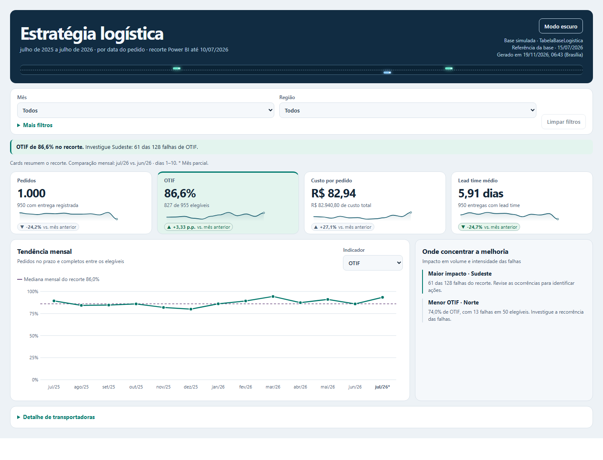
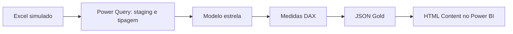
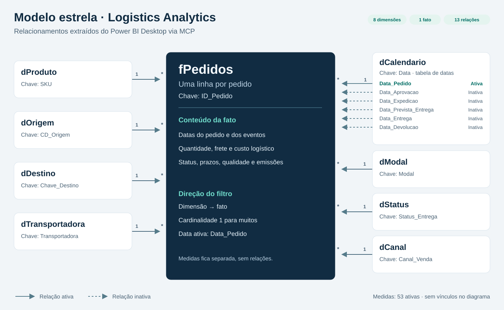

# Logistics Analytics

Estudo de caso de **BI logístico no Power BI**, desenvolvido com **OpenAI Codex** e o **Power BI Authoring MCP**. A partir de uma base simulada de pedidos, a gestão acompanha nível de serviço e custo, e a operação identifica quais pedidos revisar na carteira ativa.

**[Abrir o dashboard interativo no Power BI](https://app.powerbi.com/view?r=eyJrIjoiM2JhY2RjODEtM2IzOC00Y2ViLTgxM2EtNjU1MWQwZGRmMGMxIiwidCI6IjZkNTRhM2Y3LTM4YzItNDM2Ni1iNGNiLWVlZTg4NjI0NDI5NiJ9&pageName=556cee0099956be5cb00)** · [Reproduzir o projeto](#como-reproduzir) · [Configurar o MCP](docs/conexao-mcp.md)

[](https://app.powerbi.com/view?r=eyJrIjoiM2JhY2RjODEtM2IzOC00Y2ViLTgxM2EtNjU1MWQwZGRmMGMxIiwidCI6IjZkNTRhM2Y3LTM4YzItNDM2Ni1iNGNiLWVlZTg4NjI0NDI5NiJ9&pageName=556cee0099956be5cb00)

## Problema de negócio

A planilha reunia datas, status, custos e ocorrências. A gestão precisava decidir **onde concentrar a melhoria**, enquanto a operação precisava saber **qual pedido revisar primeiro**. O projeto organizou essas duas decisões em páginas próprias.

| Página | Pergunta que responde | Prévia |
| --- | --- | --- |
| **Capa** | Qual é o panorama do período e como está o nível de serviço? | [Ver a capa](assets/capa.png) |
| **Estratégia** | Como evoluíram serviço e custo? Onde há mais falhas ou menor OTIF? | [Ver a estratégia](assets/estrategia.png) |
| **Operação** | Onde se concentram os atrasos da carteira e quais pedidos revisar primeiro? | [Ver a operação](assets/operacao.png) |

[Veja as perguntas de negócio, as definições dos indicadores e as decisões apoiadas pelo painel.](docs/caso-de-negocio.md)

## Resultados no recorte completo

A [base simulada](docs/base/README.md) contém **1.000 pedidos únicos**, de **01/07/2025 a 10/07/2026** pela data do pedido. A carteira operacional usa a **posição registrada em 15/07/2026**.

| Indicador | Resultado | Como ler |
| --- | ---: | --- |
| OTIF | **86,60%** | 827 pedidos no prazo e completos entre 955 elegíveis. |
| Custo logístico | **R$ 82.940,80** | R$ 82,94 por pedido, considerando todo o recorte. |
| Lead time médio | **5,91 dias** | Média de 950 entregas registradas com lead time válido. |
| Carteira ativa | **24 pedidos** | 21 com status Atrasado e 3 Em trânsito na posição da fonte. |

O **Sudeste** concentrou **61 das 128 falhas de OTIF**. O **Norte** apresentou o menor OTIF (**74,0%**, em 50 elegíveis). O primeiro resultado destaca volume de falhas. O segundo indica a proporção de falhas no recorte. Ambos orientam a investigação. Os dados são simulados e a fonte não define meta ou SLA.

## Arquitetura

O desafio técnico foi manter o mesmo significado dos indicadores da planilha ao painel interativo. Isso exigiu validar a granularidade, preservar pedidos sem entrega e transportar numeradores e denominadores para os filtros internos.



O **Codex** usou o **Power BI Authoring MCP** para ler o modelo aberto, editar objetos no Desktop e executar consultas DAX. As **skills** guiaram a modelagem e a DataViz. Os **prompts** delimitaram cada etapa e seus critérios de validação. A associação das medidas aos visuais e a publicação foram feitas no Power BI.

[Arquitetura e decisões técnicas](docs/arquitetura.md) · [Skills e prompts usados](docs/prompts-e-skills.md)

## Modelo dimensional

A fato `fPedidos` tem **uma linha por pedido**, com a chave `ID_Pedido`. As oito dimensões filtram a fato em relações **1:*** unidirecionais. A `dCalendario` está marcada como tabela de datas e usa **`Data_Pedido`** como relação ativa.



[Relacionamentos e datas do modelo](docs/modelo-e-medidas.md) · [Organização das medidas](assets/organizacao-medidas.svg) · [53 expressões DAX](assets/medidas/README.md)

## Como reproduzir

1. **Prepare o ambiente.** Instale Power BI Desktop, Codex e Visual Studio Code no Windows. Siga o [guia de conexão MCP](docs/conexao-mcp.md) para instalar o servidor oficial pelo VS Code e conferir o acesso em modo de leitura.
2. **Monte o modelo.** Baixe a [planilha simulada](docs/base/README.md), configure `pCaminhoBase`, carregue as [consultas Power Query](examples/power-query/README.md) e aplique os [relacionamentos](docs/modelo-e-medidas.md).
3. **Adicione as medidas.** Comece pelas medidas de negócio e depois crie as de período, JSON Gold e apresentação. Use o [catálogo DAX](assets/medidas/README.md) e os [prompts por etapa](docs/prompts-e-skills.md). Para editar via MCP, siga a etapa de autoria no guia de conexão.
4. **Monte as páginas.** Adicione o visual HTML Content, edição Regular, e vincule a medida HTML correspondente a cada página. [Configuração no Power BI](docs/construcao-e-validacao.md#4-montar-as-páginas-no-power-bi)
5. **Valide os números.** Rode as [consultas de conferência](examples/validacao.dax) na Exibição de consulta DAX ou via MCP e compare com os resultados acima.

Para experimentar as regras com oito pedidos, use a [amostra Power Query](examples/fPedidos-demo.m) e a [consulta DAX de demonstração](examples/kpis-demo.dax). Para incorporar a versão pública em um site, use o [exemplo de iframe](examples/powerbi-embed.html).

## Validação

| Verificação | Evidência |
| --- | --- |
| Fonte e granularidade | 1.000 linhas e 1.000 IDs distintos. Os 50 pedidos sem data de entrega foram preservados. |
| Modelo | Chaves únicas nas dimensões e verificação de órfãos nas relações ativas. |
| Comparação mensal | Julho de 2026 usa os dias 1–10 de junho como comparação. São 25 pedidos contra 33 (**−24,2%**). |
| JSON e visual | Reconciliação com as medidas nativas, testes por filtros, estados vazios e renderização em largura desktop e reduzida. |

[Procedimento completo e evidências de validação](docs/construcao-e-validacao.md#5-conferir-os-resultados)

## Estrutura do repositório

```text
assets/
  medidas/       Expressões DAX por pasta do modelo
  *.svg, *.png   Diagramas do modelo e prévias das páginas
docs/
  base/          Planilha simulada, dicionário na planilha e premissas
  skills/        Skills usadas no Codex, com arquivos de referência
  prompts/       Prompts de construção e revisão
examples/
  power-query/   Consultas M exportadas, prontas para parametrizar
  fPedidos-demo.m, kpis-demo.dax  Demonstração com oito pedidos
  validacao.dax  Consultas de conferência do modelo completo
  powerbi-embed.html  Exemplo de incorporação
```

| Para entender | Para construir |
| --- | --- |
| [Caso de negócio e regras](docs/caso-de-negocio.md) | [Conexão Codex e Power BI](docs/conexao-mcp.md) |
| [Arquitetura e decisões técnicas](docs/arquitetura.md) | [Guia de construção e validação](docs/construcao-e-validacao.md) |
| [Modelo e relacionamentos](docs/modelo-e-medidas.md) | [Skills e prompts](docs/prompts-e-skills.md) |

> O relatório foi disponibilizado com **Publicar na Web**, acessível a qualquer pessoa com o link. A base e as transportadoras são simuladas. [Documentação do Power BI](https://learn.microsoft.com/en-us/power-bi/collaborate-share/service-publish-to-web)

*Referência de organização da documentação.* [Mercado do Ponto · Plataforma de Dados de Análise de Varejo](https://github.com/rafaelporfiriobarros/plataforma-dados-analise-varejo)
