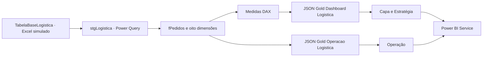
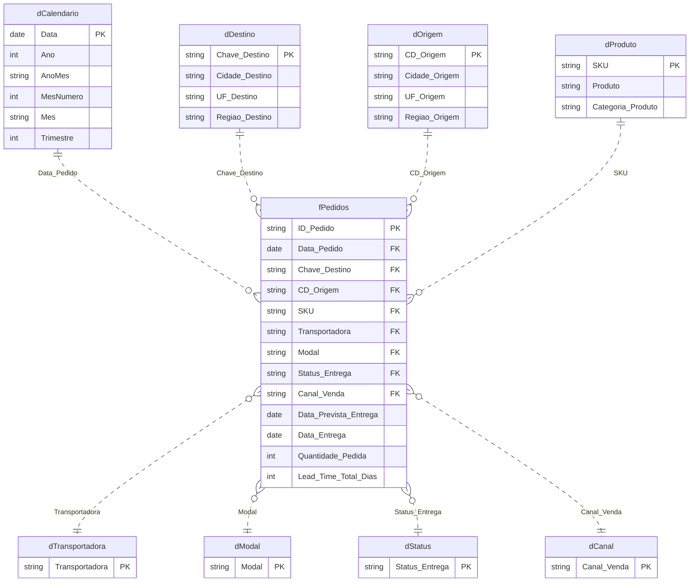

# Logistics Analytics

Dashboard de logística em **Power BI** e estudo de caso de desenvolvimento com **OpenAI Codex via Model Context Protocol (MCP)**. O projeto atende a dois objetivos:

- **Negócio.** Avaliar nível de serviço e custo por pedido, identificar onde investigar falhas e priorizar a carteira em aberto.
- **Técnico.** Demonstrar como usar IA para inspecionar um modelo no Power BI Desktop, implementar medidas DAX e verificar os resultados antes de publicar o relatório.

**[Abrir o dashboard interativo](https://app.powerbi.com/view?r=eyJrIjoiM2JhY2RjODEtM2IzOC00Y2ViLTgxM2EtNjU1MWQwZGRmMGMxIiwidCI6IjZkNTRhM2Y3LTM4YzItNDM2Ni1iNGNiLWVlZTg4NjI0NDI5NiJ9&pageName=556cee0099956be5cb00)**

## Problema e decisões apoiadas

Uma planilha reunia pedidos, datas, custos, status e ocorrências. A gestão precisava comparar o desempenho ao longo do tempo, enquanto a operação precisava localizar os pedidos que exigiam atenção na posição mais recente da base.

| Página | Pergunta de negócio | Como o dashboard ajuda |
| --- | --- | --- |
| Capa | Qual é o panorama do período? | Apresenta o nível de serviço, o volume de pedidos e o prazo médio. |
| Estratégia | Como serviço e custo evoluíram? Onde há mais falhas ou menor OTIF? | Compara tendências e mostra volume de falhas e taxa de OTIF com seus denominadores. |
| Operação | Onde os atrasos se concentram? Quais pedidos devem ser revisados primeiro? | Agrupa os atrasos registrados e ordena a fila por status e previsão de entrega. |

## Dados e resultados

O arquivo Excel contém **1.000 pedidos simulados**, com uma linha por pedido. O período de **01/07/2025 a 10/07/2026** usa a data do pedido. A carteira operacional representa a posição registrada em **15/07/2026**.

| Indicador | Resultado no recorte completo | Base de cálculo |
| --- | ---: | --- |
| OTIF | **86,60%** | 827 pedidos no prazo e completos entre 955 elegíveis. |
| Custo logístico | **R$ 82.940,80** | R$ 82,94 por pedido, considerando os 1.000 pedidos. |
| Lead time médio | **5,91 dias** | 950 entregas registradas com lead time válido. |
| Carteira ativa | **24 pedidos** | 21 com status Atrasado e 3 Em trânsito. |

O **Sudeste** concentrou **61 das 128 falhas de OTIF** e é o primeiro recorte para investigar o volume de ocorrências. O **Norte** apresentou o menor OTIF, **74,0% em 50 elegíveis**, e pede uma leitura da proporção de falhas junto ao tamanho da amostra. [Perguntas, regras e leituras de negócio](docs/caso-de-negocio.md)

## Arquitetura

A planilha passa pelo staging no Power Query e alimenta o modelo estrela. A apresentação consome dois contratos JSON, cada um preparado para as perguntas da página.

| Contrato | Páginas | Conteúdo |
| --- | --- | --- |
| `JSON Gold Dashboard Logistica` | Capa e Estratégia | KPIs e dados agrupados para recalcular taxas, custos e médias com os filtros internos. |
| `JSON Gold Operacao Logistica` | Operação | Pedidos com os status Atrasado ou Em trânsito, em nível de pedido para localizar registros na fila. |

Os dois contratos são consumidos pelo visual **HTML Content** no Power BI. As medidas nativas sustentam os KPIs e a validação. [Decisões técnicas e contratos de dados](docs/arquitetura.md)

## Desenvolvimento com IA via MCP

O **Codex** conectou-se ao modelo aberto no **Power BI Desktop** pelo **Power BI Authoring MCP**, executado localmente via STDIO. Os prompts especificaram as perguntas de negócio, a granularidade, as regras de cálculo e os critérios de aceite de cada etapa.

| Etapa | Trabalho realizado |
| --- | --- |
| Inspeção do modelo | O MCP deu acesso a tabelas, colunas, relações e medidas e permitiu executar consultas DAX de referência. A conexão inicial foi verificada em modo de leitura. |
| Autoria com escopo aprovado | A skill `dax-creation-expert` orientou a modelagem e o DAX. A skill `dataviz-html-dax` orientou os visuais HTML, os filtros e a renderização. |
| Conferência e publicação | Os resultados foram comparados em consultas DAX e em recortes do relatório. A associação das medidas aos visuais e a publicação foram feitas no Power BI. |

A IA apoiou a autoria e a verificação. No relatório publicado, os indicadores vêm do modelo semântico e os filtros são processados pelos visuais. O público usa o dashboard sem uma sessão de Codex. [As duas skills e os prompts usados no projeto](docs/prompts-e-skills.md)

## Modelo dimensional

A fato `fPedidos` tem **uma linha por pedido**, com a chave `ID_Pedido`. O diagrama mostra os relacionamentos ativos **1:***. O filtro segue da dimensão para a fato. A relação ativa do calendário usa `Data_Pedido`.

`PK` indica chave única da tabela. `FK` indica a coluna de ligação na fato. As cinco relações inativas do calendário estão na [referência do modelo](docs/modelo-e-medidas.md).

## Como reproduzir

**Pré-requisitos** · Windows com Power BI Desktop, Codex e Visual Studio Code.

1. **Configure a conexão local.** Instale o servidor oficial pelo VS Code, registre o executável no Codex com `--start` e `--readonly` e teste o acesso ao modelo. [Guia de conexão MCP](docs/conexao-mcp.md)
2. **Reconstrua o modelo.** Use a planilha simulada e as consultas Power Query versionadas. Defina `pCaminhoBase`, carregue `fPedidos` e as dimensões e configure a relação ativa do calendário.
3. **Crie as medidas e as páginas.** Para editar via Codex, aprove o escopo, troque `--readonly` por `--readwrite` e reinicie o servidor. Aplique as expressões na ordem das dependências. Adicione o visual HTML Content, edição Regular, às páginas e vincule a medida HTML correspondente. [Guia de construção](docs/construcao-e-validacao.md)
4. **Reconcilie os resultados.** Execute as consultas de conferência no modelo completo pela Exibição de consulta DAX ou pelo MCP. Compare os totais com a tabela acima e verifique os filtros no canvas. [Consultas DAX de validação](examples/validacao.dax)

## Validação e limites

| Verificação | Evidência |
| --- | --- |
| Granularidade | 1.000 linhas e 1.000 IDs distintos. Os 50 pedidos sem data de entrega foram preservados. |
| Consistência dos indicadores | Os totais do JSON foram reconciliados com as medidas nativas. A conferência incluiu recortes com filtros e sem registros. |
| Comparação mensal | Julho de 2026 cobre os dias 1 a 10. Na mesma janela de junho havia 33 pedidos, contra 25 em julho. A variação foi de **−24,2%**. |

A base é simulada e os status da Operação refletem a data de referência registrada. As concentrações de falhas indicam onde investigar. A base não estabelece metas de OTIF nem SLA contratual.

## Organização do repositório

| Pasta | Conteúdo |
| --- | --- |
| `docs/` | Caso de negócio, arquitetura, modelo e guias de conexão, construção e validação. |
| `docs/base/` | Planilha simulada, dicionário de dados e premissas. |
| `docs/skills/` e `docs/prompts/` | Instruções reutilizáveis para o Codex e prompts do desenvolvimento. |
| `assets/` | Prévias do relatório, organização das medidas e [catálogo das 53 expressões DAX](assets/medidas/README.md). |
| `examples/` | Consultas Power Query e DAX, amostra reduzida e exemplo de incorporação. |

A demonstração usa **Publicar na Web** com dados e transportadoras simulados.
