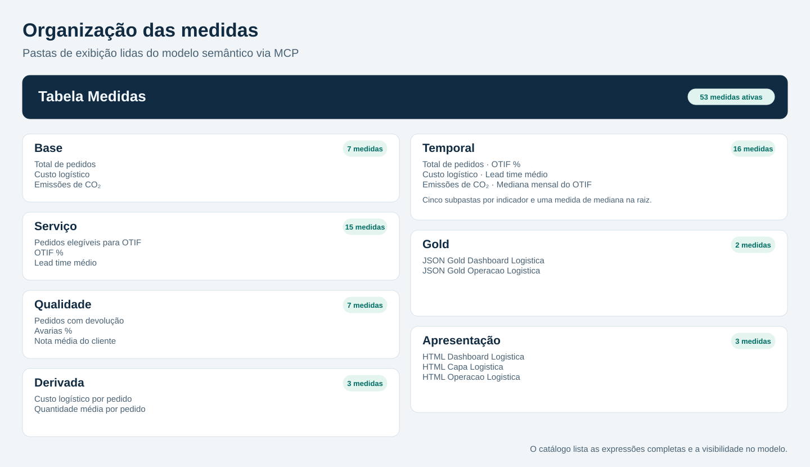

# Medidas DAX do Logistics Analytics

[Voltar ao README](../../README.md) · [Regras de negócio](../../docs/caso-de-negocio.md#regras-que-sustentam-a-leitura) · [Construção e validação](../../docs/construcao-e-validacao.md)

Exportação das **53 medidas ativas** da tabela **Medidas**, lidas no Power BI Desktop com o Power BI Authoring MCP. Os arquivos mantêm o nome e a expressão do modelo. Cópias ocultas de rollback são versões de trabalho e ficam fora deste catálogo. A coluna de visibilidade descreve a medida no modelo verificado.

## Como reutilizar

Crie ou selecione a tabela de medidas, confirme as dependências e insira cada expressão pelo comando **Nova medida** ou via MCP. Os arquivos usam a sintaxe de criação de medida da barra de fórmulas. Para validar, use as [consultas DAX](../../examples/validacao.dax) na Exibição de consulta DAX. Comece pelas medidas de Base, depois aplique as de serviço, qualidade e derivadas. A camada Temporal depende da dCalendario. As medidas JSON e HTML são as últimas.

As medidas de apresentação produzem texto, CSS e JavaScript para o visual HTML Content. Elas usam os dados entregues pelo Gold e preservam os filtros do relatório. O catálogo contém as expressões, e a [configuração do visual](../../docs/construcao-e-validacao.md#4-montar-as-páginas-no-power-bi) descreve como associá-las ao canvas.

## Base (7)

| Medida | Pasta no Power BI | Visibilidade |
| --- | --- | --- |
| [Avaliações válidas](base/avaliacoes-validas.dax) | Base | Visível |
| [Custo logístico](base/custo-logistico.dax) | Base | Visível |
| [Emissões de CO₂](base/emissoes-de-co2.dax) | Base | Visível |
| [Frete](base/frete.dax) | Base | Visível |
| [Quantidade de itens](base/quantidade-de-itens.dax) | Base | Visível |
| [Total de pedidos](base/total-de-pedidos.dax) | Base | Visível |
| [Valor dos pedidos](base/valor-dos-pedidos.dax) | Base | Visível |

## Serviço (15)

| Medida | Pasta no Power BI | Visibilidade |
| --- | --- | --- |
| [Atraso médio das entregas atrasadas](servico/atraso-medio-das-entregas-atrasadas.dax) | Serviço | Visível |
| [Atrasos válidos](servico/atrasos-validos.dax) | Serviço | Visível |
| [Entregas atrasadas](servico/entregas-atrasadas.dax) | Serviço | Visível |
| [Entregas atrasadas %](servico/entregas-atrasadas-percentual.dax) | Serviço | Visível |
| [Entregas com atraso informado](servico/entregas-com-atraso-informado.dax) | Serviço | Visível |
| [Lead time médio](servico/lead-time-medio.dax) | Serviço | Visível |
| [Lead times válidos](servico/lead-times-validos.dax) | Serviço | Visível |
| [OTIF %](servico/otif-percentual.dax) | Serviço | Visível |
| [Pedidos com status Atrasado](servico/pedidos-com-status-atrasado.dax) | Serviço | Visível |
| [Pedidos com status Atrasado %](servico/pedidos-com-status-atrasado-percentual.dax) | Serviço | Visível |
| [Pedidos elegíveis para OTIF](servico/pedidos-elegiveis-para-otif.dax) | Serviço | Visível |
| [Pedidos entregues](servico/pedidos-entregues.dax) | Serviço | Visível |
| [Pedidos In Full](servico/pedidos-in-full.dax) | Serviço | Visível |
| [Pedidos On Time](servico/pedidos-on-time.dax) | Serviço | Visível |
| [Pedidos OTIF](servico/pedidos-otif.dax) | Serviço | Visível |

## Qualidade (7)

| Medida | Pasta no Power BI | Visibilidade |
| --- | --- | --- |
| [Avarias %](qualidade/avarias-percentual.dax) | Qualidade | Visível |
| [Devoluções %](qualidade/devolucoes-percentual.dax) | Qualidade | Visível |
| [Extravios %](qualidade/extravios-percentual.dax) | Qualidade | Visível |
| [Nota média do cliente](qualidade/nota-media-do-cliente.dax) | Qualidade | Visível |
| [Pedidos com avaria](qualidade/pedidos-com-avaria.dax) | Qualidade | Visível |
| [Pedidos com devolução](qualidade/pedidos-com-devolucao.dax) | Qualidade | Visível |
| [Pedidos extraviados](qualidade/pedidos-extraviados.dax) | Qualidade | Visível |

## Derivada (3)

| Medida | Pasta no Power BI | Visibilidade |
| --- | --- | --- |
| [Custo logístico por pedido](derivada/custo-logistico-por-pedido.dax) | Derivada | Visível |
| [Custo logístico sobre valor dos pedidos](derivada/custo-logistico-sobre-valor-dos-pedidos.dax) | Derivada | Visível |
| [Quantidade média por pedido](derivada/quantidade-media-por-pedido.dax) | Derivada | Visível |

## Temporal (16)

| Medida | Pasta no Power BI | Visibilidade |
| --- | --- | --- |
| [Mediana mensal do OTIF](temporal/mediana-mensal-do-otif.dax) | Temporal | Visível |
| [Custo logístico mês anterior](temporal/custo-logistico/custo-logistico-mes-anterior.dax) | Temporal / Custo logístico | Visível |
| [Custo logístico variação absoluta](temporal/custo-logistico/custo-logistico-variacao-absoluta.dax) | Temporal / Custo logístico | Visível |
| [Custo logístico variação percentual](temporal/custo-logistico/custo-logistico-variacao-percentual.dax) | Temporal / Custo logístico | Visível |
| [Emissões de CO₂ mês anterior](temporal/emissoes-de-co2/emissoes-de-co2-mes-anterior.dax) | Temporal / Emissões de CO₂ | Visível |
| [Emissões de CO₂ variação absoluta](temporal/emissoes-de-co2/emissoes-de-co2-variacao-absoluta.dax) | Temporal / Emissões de CO₂ | Visível |
| [Emissões de CO₂ variação percentual](temporal/emissoes-de-co2/emissoes-de-co2-variacao-percentual.dax) | Temporal / Emissões de CO₂ | Visível |
| [Lead time médio mês anterior](temporal/lead-time-medio/lead-time-medio-mes-anterior.dax) | Temporal / Lead time médio | Visível |
| [Lead time médio variação absoluta](temporal/lead-time-medio/lead-time-medio-variacao-absoluta.dax) | Temporal / Lead time médio | Visível |
| [Lead time médio variação percentual](temporal/lead-time-medio/lead-time-medio-variacao-percentual.dax) | Temporal / Lead time médio | Visível |
| [OTIF % mês anterior](temporal/otif-percentual/otif-percentual-mes-anterior.dax) | Temporal / OTIF % | Visível |
| [OTIF % variação absoluta](temporal/otif-percentual/otif-percentual-variacao-absoluta.dax) | Temporal / OTIF % | Visível |
| [OTIF % variação percentual](temporal/otif-percentual/otif-percentual-variacao-percentual.dax) | Temporal / OTIF % | Visível |
| [Total de pedidos mês anterior](temporal/total-de-pedidos/total-de-pedidos-mes-anterior.dax) | Temporal / Total de pedidos | Visível |
| [Total de pedidos variação absoluta](temporal/total-de-pedidos/total-de-pedidos-variacao-absoluta.dax) | Temporal / Total de pedidos | Visível |
| [Total de pedidos variação percentual](temporal/total-de-pedidos/total-de-pedidos-variacao-percentual.dax) | Temporal / Total de pedidos | Visível |

## Gold (2)

| Medida | Pasta no Power BI | Visibilidade |
| --- | --- | --- |
| [JSON Gold Dashboard Logistica](gold/json-gold-dashboard-logistica.dax) | Gold | Visível |
| [JSON Gold Operacao Logistica](gold/json-gold-operacao-logistica.dax) | Gold | Oculta |

## Apresentação (3)

| Medida | Pasta no Power BI | Visibilidade |
| --- | --- | --- |
| [HTML Capa Logistica](apresentacao/html-capa-logistica.dax) | Apresentação | Visível |
| [HTML Dashboard Logistica](apresentacao/html-dashboard-logistica.dax) | Apresentação | Visível |
| [HTML Operacao Logistica](apresentacao/html-operacao-logistica.dax) | Apresentação | Visível |
