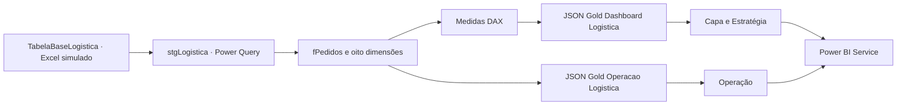

# Arquitetura e decisões técnicas

[Voltar ao README](../README.md) · [Modelo e relacionamentos](modelo-e-medidas.md) · [Construção e validação](construcao-e-validacao.md)

## Fluxo dos dados

| Etapa | Responsabilidade | Artefato |
| --- | --- | --- |
| Fonte | Fornece pedidos, datas, valores e ocorrências. A planilha inclui dicionário e premissas. | [Planilha simulada](base/README.md) |
| Staging e modelo | Tipam e padronizam a fonte, preservam datas nulas e carregam uma fato com uma linha por pedido. | [Consultas M](../examples/power-query/README.md) |
| DAX | Define indicadores de volume, serviço, custo, qualidade e tempo sob o contexto de filtro do modelo. | [Medidas exportadas](../assets/medidas/README.md) |
| JSON Gold | Serializa o contexto de cada página para consumo pelo HTML. Há um contrato para análise agregada e outro para a fila nominal. | [Contrato dos dados](construcao-e-validacao.md#3-entregar-dados-estruturados-ao-html) |
| Apresentação | Renderiza Capa, Estratégia e Operação no HTML Content. A publicação disponibiliza a demonstração no Service. | [Montagem das páginas](construcao-e-validacao.md#4-montar-as-páginas-no-power-bi) |

## Fluxo de autoria com IA

1. **Conectar e inspecionar.** O Codex chama o Power BI Authoring MCP via STDIO para identificar a instância do Desktop, ler tabelas e relações e executar uma consulta de referência. [Guia de conexão](conexao-mcp.md)
2. **Implementar por etapas.** A skill de DAX orienta a validação do modelo, das medidas e dos denominadores. A skill de DataViz orienta o contrato JSON, a camada HTML e a revisão visual. Os prompts registram o objetivo e as condições de aceite de cada etapa. [Skills e prompts](prompts-e-skills.md)
3. **Verificar no modelo e no canvas.** A execução DAX permite reconciliar resultados em diferentes recortes. No Desktop, a revisão cobre a associação da medida ao visual, os filtros e a renderização. A publicação ocorre pelo Power BI Service. [Consultas de conferência](../examples/validacao.dax)

O MCP opera sobre o modelo aberto. O relatório continua exibindo as medidas e os visuais sem uma sessão de Codex em execução.

## Decisões que sustentam o painel

| Decisão | Consequência prática |
| --- | --- |
| **Uma linha por pedido** | `ID_Pedido` é único e os valores monetários refletem a granularidade observada. Uma nova fonte com vários itens por pedido exige uma nova validação das somas e das contagens. |
| **Calendário pela data do pedido** | Pedidos de um mês formam o grupo usado no histórico estratégico. As relações inativas documentam outras datas de evento. A data de atualização posiciona a carteira operacional. |
| **Contagens e somas no JSON estratégico** | Os filtros internos somam sucessos e elegíveis para calcular OTIF. O lead time usa a soma dos dias válidos dividida pela contagem de observações. O payload estratégico dispensa o ID do pedido. |
| **Base de comparação independente** | Quando o recorte atual não contém todos os dias do mês anterior, `baseComparacao` fornece o histórico para o badge temporal. Essa busca altera somente o filtro do calendário. Os demais filtros continuam ativos e a base de comparação fica fora dos totais do recorte. |
| **Fila operacional em nível de pedido** | O JSON de Operação traz o ID e os campos necessários para localizar o pedido. A fila usa os status da fonte e, dentro de cada status, a previsão mais antiga. O recorte da carteira representa a posição registrada no arquivo. |

A Estratégia analisa serviço e custo ao longo do tempo. A Operação usa a carteira registrada para priorizar a revisão dos pedidos. As duas leituras compartilham o modelo e têm populações diferentes. [Definições e limites](caso-de-negocio.md#regras-que-sustentam-a-leitura)
