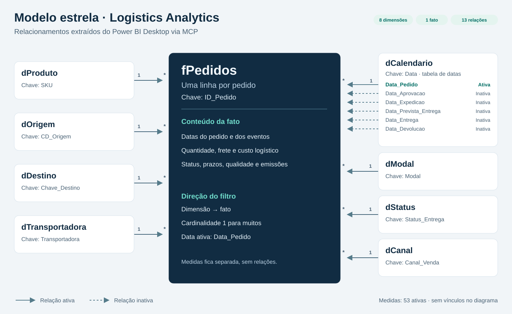
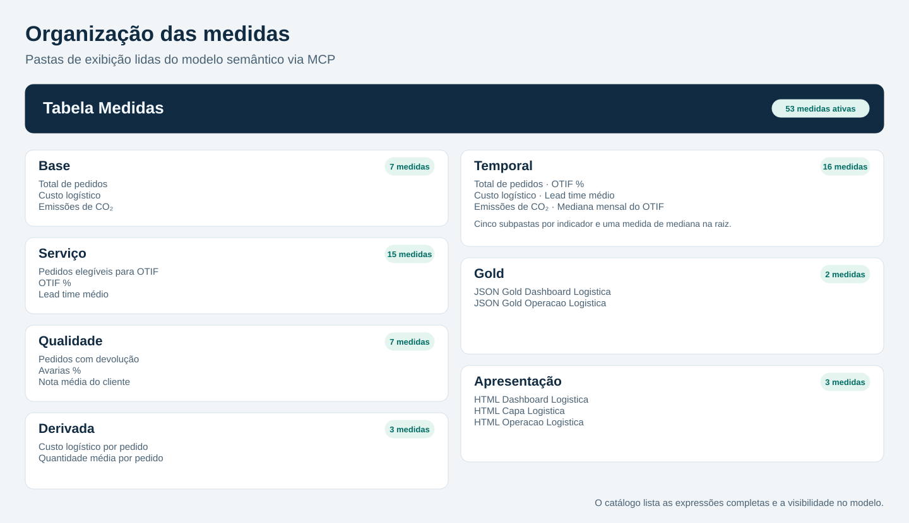

# Modelo semântico e medidas

[Voltar ao README](../README.md) · [Catálogo das 53 medidas](../assets/medidas/README.md)

A tabela abaixo registra o modelo final lido pelo Power BI Authoring MCP. O filtro unidirecional segue da dimensão para a fato. O calendário está marcado como tabela de datas.

## Relacionamentos

| Dimensão e chave | Coluna em fPedidos | Cardinalidade | Estado |
| --- | --- | --- | --- |
| dProduto[SKU] | SKU | 1 → * | Ativo |
| dOrigem[CD_Origem] | CD_Origem | 1 → * | Ativo |
| dDestino[Chave_Destino] | Chave_Destino | 1 → * | Ativo |
| dTransportadora[Transportadora] | Transportadora | 1 → * | Ativo |
| dModal[Modal] | Modal | 1 → * | Ativo |
| dStatus[Status_Entrega] | Status_Entrega | 1 → * | Ativo |
| dCanal[Canal_Venda] | Canal_Venda | 1 → * | Ativo |
| dCalendario[Data] | Data_Pedido | 1 → * | Ativo |
| dCalendario[Data] | Data_Aprovacao | 1 → * | Inativo |
| dCalendario[Data] | Data_Expedicao | 1 → * | Inativo |
| dCalendario[Data] | Data_Prevista_Entrega | 1 → * | Inativo |
| dCalendario[Data] | Data_Entrega | 1 → * | Inativo |
| dCalendario[Data] | Data_Devolucao | 1 → * | Inativo |

## Pastas de medidas

A imagem foi gerada a partir dos nomes das pastas e das medidas que o MCP retornou. [As expressões completas](../assets/medidas/README.md) podem ser consultadas individualmente.
